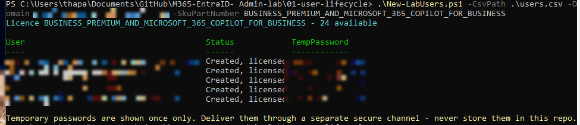
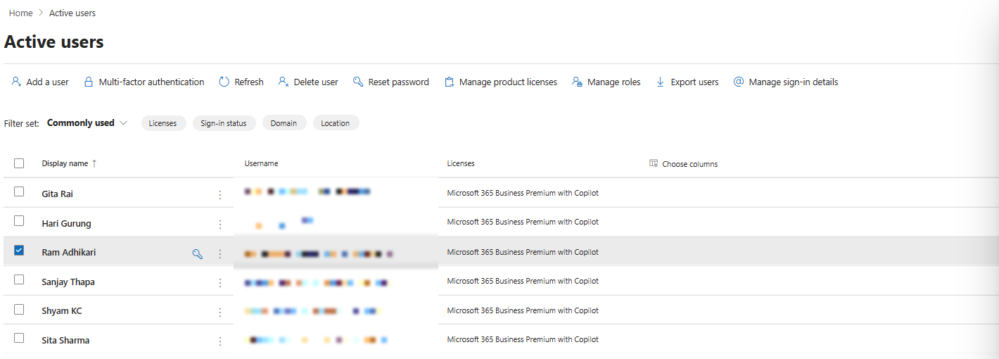
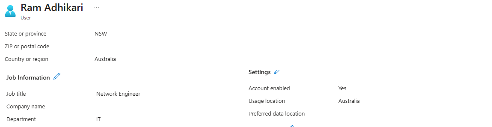
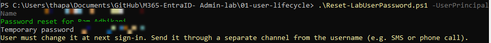
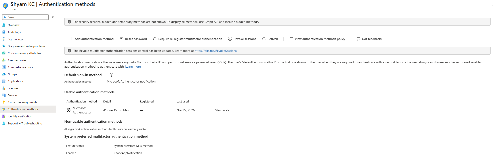
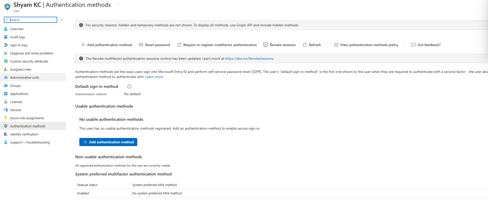
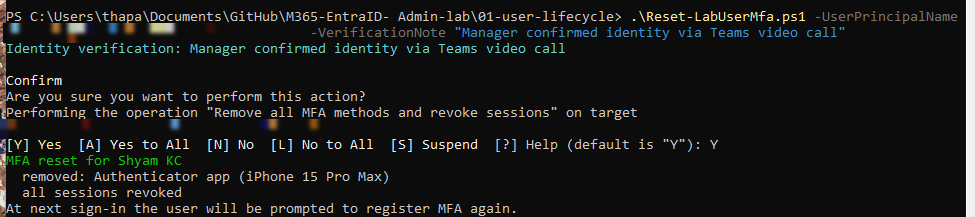
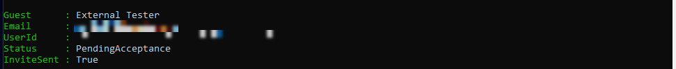
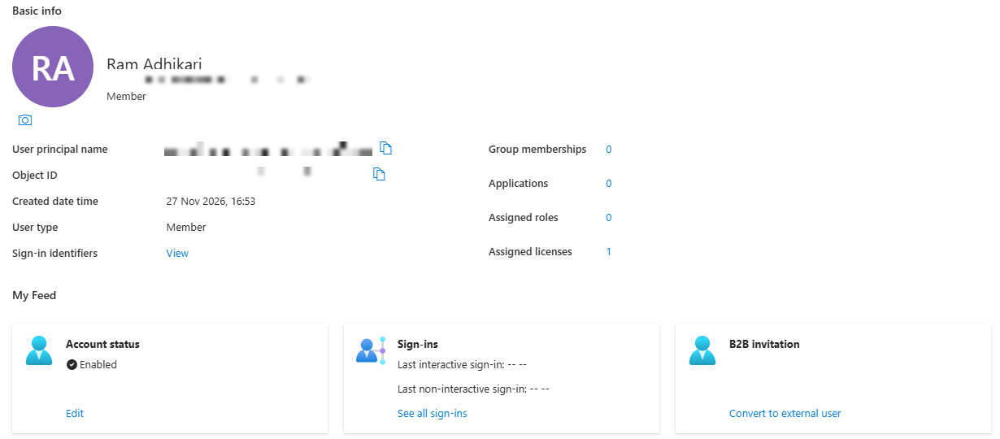
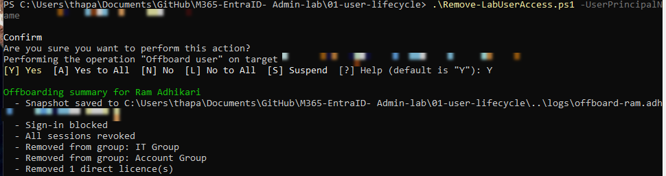

# 01 – User Lifecycle (Joiner · Mover · Leaver)

## Scenario
A small Australian business needs its helpdesk to handle the full life of a user account:
onboard new staff with licences and MFA, handle password and MFA resets, update
records when people change roles, give external people guest access, and offboard
leavers securely.

Each task was first completed in the **Microsoft 365 / Entra admin centre**, then
automated with **PowerShell (Microsoft Graph SDK)** so it is repeatable and auditable.

## Tasks covered

| # | Task | Script |
|---|------|--------|
| 1 | Create users Ram Adhikari and Shyam KC, assign licence, enforce MFA | [`New-LabUsers.ps1`](New-LabUsers.ps1) + [`users.csv`](users.csv) |
| 2 | Reset Ram's password – temporary password, must change at next sign-in | [`Reset-LabUserPassword.ps1`](Reset-LabUserPassword.ps1) |
| 3 | Update Ram's department to **IT** and job title to **Network Engineer** | [`Update-LabUserProfile.ps1`](Update-LabUserProfile.ps1) |
| 4 | Reset Shyam's MFA after he lost his phone | [`Reset-LabUserMfa.ps1`](Reset-LabUserMfa.ps1) |
| 5 | Block Ram, remove him from all groups and remove his licence | [`Remove-LabUserAccess.ps1`](Remove-LabUserAccess.ps1) |
| 6 | Create a guest user | [`New-LabGuestUser.ps1`](New-LabGuestUser.ps1) |

> Admin roles (Global Reader, Authentication Administrator) → [`02-roles-rbac`](../02-roles-rbac)
> Alias, forwarding and auto-reply → [`05-exchange`](../05-exchange)

## Prerequisites
- PowerShell 7+
- Microsoft Graph PowerShell SDK: `Install-Module Microsoft.Graph -Scope CurrentUser`
- A Microsoft 365 tenant with an admin account (lab/trial tenant, **never production**)

## How to run
```powershell
# 1. Connect (once per session)
.\Connect-Lab.ps1 -TenantId yourtenant.onmicrosoft.com

# 2. Always preview first with -WhatIf
.\New-LabUsers.ps1 -CsvPath .\users.csv -Domain yourtenant.onmicrosoft.com -WhatIf

# 3. Run for real
.\New-LabUsers.ps1 -CsvPath .\users.csv -Domain yourtenant.onmicrosoft.com -SkuPartNumber SPB -EnforcePerUserMfa

.\Reset-LabUserPassword.ps1 -UserPrincipalName ram.adhikari@yourtenant.onmicrosoft.com
.\Update-LabUserProfile.ps1 -UserPrincipalName ram.adhikari@yourtenant.onmicrosoft.com -Department IT -JobTitle "Network Engineer"
.\Reset-LabUserMfa.ps1 -UserPrincipalName shyam.kc@yourtenant.onmicrosoft.com -VerificationNote "Manager confirmed via Teams call" -IssueTemporaryAccessPass
.\New-LabGuestUser.ps1 -Email guest@example.com -DisplayName "External Tester"
.\Remove-LabUserAccess.ps1 -UserPrincipalName ram.adhikari@yourtenant.onmicrosoft.com
```

## Results

### Onboarding – 5 users created and licensed from CSV



### Mover – Ram's job details updated


### Password reset – temporary password, change at next sign-in


### Lost phone – Shyam's MFA reset
| Before | After |
|---|---|
|  |  |



### Guest access


### Leaver – Ram offboarded
| Before | After |
|---|---|
|  |  |



## Security notes

**Temporary passwords** – Generated with a cryptographically secure random generator,
shown on screen once, never saved to disk, and must be changed at first sign-in.
They should be sent through a different channel from the username (e.g. SMS, phone).
Emailing a password to a personal Gmail works in a lab, but in production a
**Temporary Access Pass** is the safer option.

**MFA resets are a social-engineering target** – Attackers phone helpdesks pretending
to be a user who "lost their phone" (this was the initial access in the 2023 MGM Resorts
breach). The MFA reset script will not run without a `-VerificationNote` recording *how*
identity was verified, e.g. a call-back to a number from the HR system or confirmation
from the user's manager.

**Per-user MFA vs Conditional Access** – `-EnforcePerUserMfa` uses the legacy
per-user setting to match the lab task. Microsoft's recommended approach is a
**Conditional Access policy** requiring MFA for all users (or Security Defaults for
tenants without Entra ID P1). This is covered in the security baseline project.

**Offboarding order matters** – Disabling the account alone does not end existing
sessions; a stolen or still-signed-in device can keep working until its token expires.
The script blocks sign-in and **revokes sessions first**, then removes admin roles,
groups and licences. A JSON snapshot is saved before any change for audit and rollback.

**Mailbox data** – Removing the Exchange licence deletes the mailbox after 30 days.
If the mailbox is needed, convert it to a shared mailbox first (see section 05).

## What I learned
<!-- Draft based on what actually happened – rewrite in your own words -->
- **Graph permissions are split by risk.** Creating users worked with `User.ReadWrite.All`, but resetting
  a password returned `403 Authorization_RequestDenied`. Password resets need the separate
  `User-PasswordProfile.ReadWrite.All` scope. I added it to the connection rather than using a broader role.
- **Sign-in troubleshooting.** The Windows Web Account Manager (WAM) popup rejected my work account as
  "doesn't exist" on a brand-new tenant. Disabling WAM (`Set-MgGraphOption -DisableLoginByWAM $true`) and
  targeting the tenant with `-TenantId` fixed it.
- **Validate input before calling the API.** The licence check listed the valid SKU name when I passed a
  placeholder, and the guest script rejected a malformed email before anything was sent.
- **UsageLocation must be set before a licence can be assigned** – the create script sets it from the CSV.
- **Disabling an account is not enough.** Existing sessions keep working until tokens expire, so offboarding
  revokes sessions straight after blocking sign-in.
